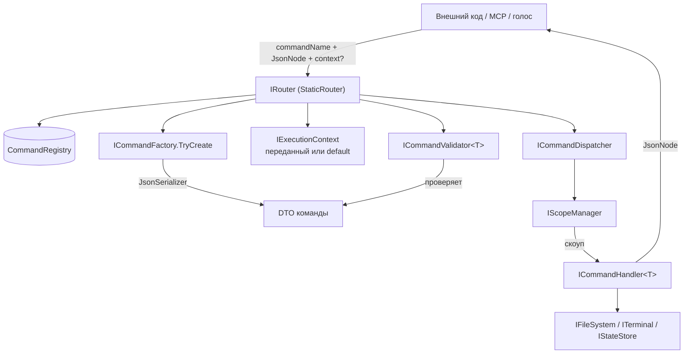

### 1. Базовые типы и форматы

- **`ICommand`** (`Kouki.Mugura.Commands`) — маркерный интерфейс без членов. DTO команды — `record`, реализующий `ICommand`.
- **`JsonNode`** (`System.Text.Json.Nodes`) — универсальный тип аргумента и результата: объект, массив, скаляр, `null`.
- **`IExecutionContext`** (`Kouki.Shimi.Context`) — контейнер окружения: `Name`, `FileSystem`, `Terminal`, `StateStore`, `GetService<T>()`.
- **`IContextRegistry`** (`Kouki.Shimi.Context`) — реестр контекстов по имени + контекст по умолчанию; потокобезопасен.

### 2. Регистрация команд

```csharp
[AttributeUsage(AttributeTargets.Class, Inherited = false)]
public sealed class CommandAttribute : Attribute
{
    public CommandAttribute(string name);
    public string Name { get; }
    public string? Description { get; set; }
    public bool RequiresConfirmation { get; set; }
    public CommandCategory Category { get; set; } = CommandCategory.Uncategorized;
    public string? Example { get; set; }
}
```

Атрибут ставится на **класс-хендлер**. `CommandRegistry(IEnumerable<Assembly>)` в конструкторе перебирает типы, требует `[Command]` и реализацию `ICommandHandler<>`, берёт тип DTO из generic-аргумента и собирает `ValidationAttribute` с публичных свойств DTO. Итог — `CommandEntry`:

```csharp
public sealed record CommandEntry(
    Type CommandType, Type HandlerType, string Name, string? Description,
    bool RequiresConfirmation, CommandCategory Category,
    IReadOnlyList<ValidationRule> ValidationRules, string? Example);

public sealed record ValidationRule(string PropertyName, ValidationAttribute Attribute);
```

`CommandCategory` — `[Flags]`, члены `1 << n` (`Navigation = 2`, …, `Integration = 256`), `Uncategorized = 0`.

### 3. Создание команды (фабрика)

```csharp
public interface ICommandFactory
{
    ICommand? Create(CommandEntry entry, JsonNode? argument);
    bool TryCreate(CommandEntry entry, JsonNode? argument, out ICommand? command, out string? error);
}
```

`CommandFactory`:

- сериализует через `JsonSerializer.Deserialize(node, entry.CommandType, SerializerOptions)`, где `SerializerOptions = new(JsonSerializerDefaults.Web) { PropertyNameCaseInsensitive = true, ReadCommentHandling = JsonCommentHandling.Skip, AllowTrailingCommas = true }`;
- `null` нормализует в `new JsonObject()`, поэтому DTO без аргументов создаётся корректно;
- ошибки формы (`JsonException`, `NotSupportedException`) превращает в `error`, а не в исключение;
- `Create` — обёртка над `TryCreate`.

### 4. Валидация

```csharp
public interface ICommandValidator<TCommand> where TCommand : ICommand
{
    bool TryValidate(TCommand command, out string? error);
}
```

`DataAnnotationsValidator<TCommand>` получает `CommandRegistry`, берёт `ValidationRules` для `TCommand`, читает свойства через рефлексию и собирает сообщения (`string.Join("; ", errors)`). Регистрируется открытым generic'ом в `AddMugura`:

```csharp
services.TryAddScoped(typeof(ICommandValidator<>), typeof(DataAnnotationsValidator<>));
```

Пользовательская реализация для конкретной команды регистрируется после `AddMugura` и перекрывает умолчание.

### 5. Управление скоупами

```csharp
public interface IScopeManager
{
    Task<T> RunInScopeAsync<T>(Func<IServiceProvider, Task<T>> action);
}
```

`ScopeManager` создаёт `AsyncServiceScope` через `IServiceScopeFactory`, выполняет `action`, освобождает скоуп `await using`.

### 6. Диспетчер команд

```csharp
public interface ICommandDispatcher
{
    Task<JsonNode> SendAsync<TCommand>(TCommand command, IExecutionContext context,
        CancellationToken cancellationToken = default) where TCommand : ICommand;
}
```

`CommandDispatcher.SendAsync`:

1. `ArgumentNullException.ThrowIfNull(command)` / `ThrowIfNull(context)` — контекст обязателен;
2. открывает скоуп через `IScopeManager`;
3. резолвит `ICommandHandler<TCommand>` из скоупа и вызывает `HandleAsync(command, context, ct)`.

### 7. Хендлер команд

```csharp
public interface ICommandHandler<in TCommand> where TCommand : ICommand
{
    Task<JsonNode> HandleAsync(TCommand command, IExecutionContext? context = null,
        CancellationToken cancellationToken = default);
}
```

Хендлер помечен `[Command]`, живёт в DI как Scoped, получает глобальные зависимости через конструктор, а окружение — через `context` (`context.FileSystem`, `context.Terminal`, `context.StateStore`). Параметр `context` в интерфейсе nullable, но диспетчер всегда передаёт не-null.

### 8. Роутинг

```csharp
public interface IRouter
{
    Task<JsonNode> RouteAsync(string commandName, JsonNode? argument,
        IExecutionContext? context = null, CancellationToken cancellationToken = default);
}
```

`StaticRouter` (конструктор: `CommandRegistry`, `ICommandFactory`, `IServiceProvider`, `ICommandDispatcher`):

1. `GetEntry(commandName)`; нет — `{"error": "Unknown command: ..."}`;
2. `_factory.TryCreate(...)`; ошибка — `{"error": ...}`;
3. `context ?? _services.GetService<IContextRegistry>()?.GetDefaultContext()`; нет контекста — `{"error": "No execution context: ..."}`;
4. валидатор резолвится из `_services.CreateScope()` по `typeof(ICommandValidator<>).MakeGenericType(entry.CommandType)`; нарушение — `{"error": ...}`;
5. вызов диспетчера через кешированный делегат `DispatchCore<TCommand>`;
6. весь конвейер обёрнут в `try/catch`: исключение → `{"error": message, "type": TypeName}`, `OperationCanceledException` пробрасывается.

`DelegatingRouter` — абстрактная обёртка над `IRouter` (логирование, метрики, авторизация, фолбэк). `MushiRouter` и `RemoteRouter` не реализованы.

### 9. Контексты и реестр

```csharp
public interface IContextRegistry
{
    IExecutionContext? GetContext(string name);          // fallback → default
    void RegisterContext(string name, IExecutionContext context);
    void SetDefaultContext(IExecutionContext context);
    void SetDefaultContext(string name);                // имя должно быть зарегистрировано
    IExecutionContext? GetDefaultContext();
    bool TryGetDefaultContext([NotNullWhen(true)] out IExecutionContext? context);
}
```

- `ContextRegistry` — `ConcurrentDictionary` + `Volatile`-поле; неизвестное имя в `GetContext` откатывается на контекст по умолчанию; `TryGetDefaultContext` — предпочтительный способ проверки.
- `BaseExecutionContext` — обычный класс; `GetService<T>()` берёт сервисы из переданного словаря.
- `InMemoryStateStore` — `ConcurrentDictionary<string, object?>`, потокобезопасен.
- `AddShimiContext()` — `TryAddSingleton<IContextRegistry, ContextRegistry>()` + `TryAddSingleton<IStateStore, InMemoryStateStore>()`.

### 10. Адаптеры окружения

Интерфейсы — `Kouki.Shimi.ServiceAbstractions`:

- `IFileSystem` — `ReadBytesAsync`, `WriteBytesAsync`, `ExistsAsync`, `GetTreeAsync`;
- `ITextFileSystem` — `ReadTextAsync`, `WriteTextAsync`, `AppendTextAsync`;
- `IJsonFileSystem` — `ReadJsonAsync<T>`, `WriteJsonAsync<T>`;
- `ITerminal` — `RunCommandAsync`;
- `IStateStore` — `GetAsync<T>`, `SetAsync<T>`, `RemoveAsync`;
- `ITelemetryLogger` — `LogEvent`, `LogError`.

Реализации — `Kouki.Ubusuna.Adapters`: `ConsoleFileSystem` (корень + защита от выхода за него), `ConsoleTerminal` (`ArgumentList`, кроссплатформенный shell, код выхода и stderr в исключении). Регистрация — `AddUbusuna()` или `UbusunaBuilder`.

### 11. Полный цикл



1. **Вход** — `IRouter.RouteAsync(commandName, argument, context?)`.
2. **Реестр** — `CommandEntry` по имени команды.
3. **Фабрика** — JSON → DTO (`TryCreate`).
4. **Контекст** — переданный или из `IContextRegistry`.
5. **Валидация** — `ICommandValidator<T>` из скоупа.
6. **Диспетчер** — скоуп → хендлер → `HandleAsync`.
7. **Ошибки** — любое исключение (кроме отмены) на границе `RouteAsync` → `{"error", "type"}`.

### 12. Расширение роутинга (IntentRouter)

`IntentRouter` — внешний наследник `DelegatingRouter`: принимает голосовую фразу, классифицирует интент (ML.NET → BERT → LLM), извлекает слоты, собирает `JsonNode` и вызывает `base.RouteAsync(commandName, argument, context)`. В репозитории его нет.

### 13. Логирование и телеметрия

`ITelemetryLogger` (`LogEvent`, `LogError`) предназначен для роутеров-декораторов и хендлеров: успешные и неудачные выполнения, отказы интентов, долгие вызовы. Через DI он не входит в `IExecutionContext`.

### 14. Примечания

- Все асинхронные методы принимают `CancellationToken`.
- Входной аргумент — `JsonNode?`; `null` нормализуется фабрикой в `{}`.
- Выход — `JsonNode`: скаляр, объект или `{"error": "..."}`.
- Жизненные циклы: `CommandRegistry`, `ICommandFactory`, `IScopeManager`, `ICommandDispatcher`, `IRouter`, `IContextRegistry` — синглтоны; хендлеры и валидаторы — Scoped.
- `IExecutionContext` не является DI-сервисом и не привязан к скоупу — передаётся явно.
- `StaticRouter` кеширует делегаты валидатора и диспетчера по типу команды.
- Source Generators (регистрация команд, кеш `JsonTypeInfo`) — план, в коде нет.

### 15. Сервер, бот и дашборд: где что происходит

```
Telegram ─┐
ESP32 ────┤→ Kagedama.api /api/intake ──→ TaskIntakeService.IntakeAsync
дашборд ──┤                                    │
агент ────┘ (через Kagedama.mcp → те же классы) ├→ IIntentClassifier (Kouki.Yasabi)
                                                ├→ CommandRegistry / IRouter (Kouki.Mugura)
                                                └→ ITaskStore / IClassificationJournal / IActionLog
```

- Хендлеры команд (`list_tasks`, `complete_task`) и приём живут в `Kouki.Kagedama`, а не в
  веб-проекте: этим же классом пользуются MCP-сервер и тесты.
- Все уверенные интенты идут в диспатчер; создание задачи — обычная команда `add_task`,
  она помечает ответ `"created": true`. Задачу сам приём создаёт только для неуверенных фраз
  (статус `needs_review`) — команды для них не существует.
- MCP-сервер повторяет HTTP-путь без веба: те же сервисы, только транспорт stdio и лог в stderr.
### 16. Контракты и состояние: что изменилось в типах

```csharp
// Kouki.Kagedama.Contracts — без зависимостей
Task<T?> IStateStore.GetAsync<T>(string key, CancellationToken ct = default);
Task    IStateStore.SetAsync<T>(string key, T value, CancellationToken ct = default);
Task    IStateStore.RemoveAsync(string key, CancellationToken ct = default);

IExecutionContext? context = registry.GetDefaultContext();
var clock = context?.GetService<IClock>();        // null, если сервиса нет
var must  = context!.GetRequiredService<IClock>("в логе"); // исключение с подсказкой
```

Порядок разрешения сервиса в `BaseExecutionContext`: словарь `AddService` → `IServiceProvider`
из конструктора → `null`. «Железные» сервисы (`IFileSystem`, `ITerminal`, `IStateStore`)
удалить нельзя.

Хосты регистрируют `SqliteStateStore` как `IStateStore` **до** `AddShimiContext()`, иначе
`TryAddSingleton` оставит `InMemoryStateStore`. Проверить, что получилось:
`GET /api/context` или MCP `kouki_context`.
### 17. Голос: путь одного WAV

```
POST /api/voice  (тело — WAV целиком)
  WavReader.TryParse           → WavAudio (16 кГц, моно, 16 бит) | 415
  ISpeechTranscriber           → TranscriptionResult (текст, уверенность или null)
  FileAudioStore.SaveAsync     → audio/{source}/{yyyyMMdd}/{HHmmss}_{guid}.wav
  journal.AnnotateAudioAsync   → classifications.asr_confidence / audio_path
  VoiceIntakeService.AcceptAsync
      intake.IntakeAsync(text, source, ct, asrConfidence, audioPath)
  TaskIntakeService.IntakeAsync
      classify → intent → (команда → IRouter → handler) | needs_review
  IActionLog.RecordAsync       → actions(kind=intake, outcome, duration_ms)
```

Новые типы: `WavAudio`/`WavReader` (Kouki.Kagedama), `IAudioStore`/`FileAudioStore`, `VoiceIntakeResult(Transcription, Intake, AudioPath, Error)`, `VoiceResponse` в контрактах API, `IExecutionContext.GetRequiredService<T>()` и `AddService<T>()` для расширяемых контекстов, `AnnotateAudioAsync`/`ListLabeledAsync` в журнале.

`IntakeAsync` вырос двумя необязательными параметрами (`asrConfidence`, `audioPath`), но остался единственной точкой приёма: текст из Telegram, дашборда и голоса проходит один и тот же путь, отличаются только источник и наличие аудио. Порога на уверенность распознавания нет — маршрут решает классификатор интента, а вероятность (если модель её отдаст) остаётся метаданными.